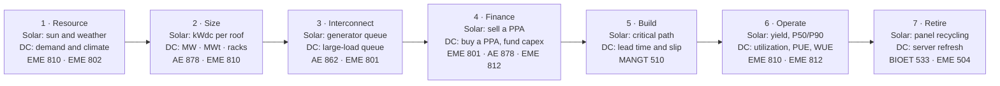
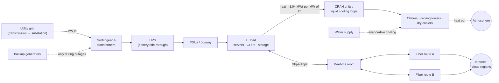

# Data Centers as Energy Systems:  A Field Guide

### What a Master's degree in Renewable Energy & Sustainbility Systems teaches you about data center capacity + energy planning

> **What this is.** A plain-language companion to the
> [Multi-Site Data Center Capacity & Energy Simulator](README.md). It explains the vocabulary data center and utility
> people use, and it traces each idea back to where I learned it: my Penn State master's in Renewable Energy
> and Sustainability Systems (RESS, 2017-2020). That covers the solar farms, battery deals, grid models and
> project finance I studied there, re-pointed at the biggest new energy projects of the 2020s.
>
> **Who it's for.** Anyone who knows some algebra and has heard of a power plant, but has never sat in a
> data center capacity review.
>
> **Synthetic data.** Every facility, number and dollar figure in the simulator is invented for demonstration.
> Order-of-magnitude statements about the real industry are flagged as such.

---

## Contents

**Part I: The frame**

1. [The task in one page](#1-the-task-in-one-page)
2. [The big idea: a utility project from the other side of the meter](#2-the-big-idea-a-utility-project-from-the-other-side-of-the-meter)
3. [The degree, course by course](#3-the-degree-course-by-course)
4. [Systems thinking: stocks, flows, delays and limits](#4-systems-thinking-stocks-flows-delays-and-limits)
5. [Energy first principles: what goes in comes out as heat](#5-energy-first-principles-what-goes-in-comes-out-as-heat)

**Part II: The project life cycle, stage by stage**

6. [Resource assessment → forecasting demand and climate](#6-resource-assessment--forecasting-demand-and-climate)
7. [Sizing: how big, and what fills up first](#7-sizing-how-big-and-what-fills-up-first)
8. [Heat and water: the water-energy nexus](#8-heat-and-water-the-waterenergy-nexus)
9. [The grid: interconnection, power flow and markets](#9-the-grid-interconnection-power-flow-and-markets)
10. [Storage, firming and 24/7 clean power](#10-storage-firming-and-247-clean-power)
11. [Money: discounting, levelized cost and the capital plan](#11-money-discounting-levelized-cost-and-the-capital-plan)
12. [Carbon accounting](#12-carbon-accounting)
13. [Building on time: schedule risk](#13-building-on-time-schedule-risk)
14. [Ethics, life cycle and the neighbors](#14-ethics-life-cycle-and-the-neighbors)
15. [Siting, distance and data backhaul](#15-siting-distance-and-data-backhaul)

**Part III: Putting it to work**

16. [The six sites as case studies](#16-the-six-sites-as-case-studies)
17. [Worked math](#17-worked-math)
18. [What the model deliberately leaves out](#18-what-the-model-deliberately-leaves-out)
19. [How to say it in a meeting](#19-how-to-say-it-in-a-meeting)
20. [Further reading](#20-further-reading)

---

# Part I: The frame

## 1. The task in one page

A regional operations leader runs **six data centers** (DC1-DC6). Each one has three things that can run out:

| Resource | Unit | Runs out when… |
|---|---|---|
| **Electrical power** | MW (megawatts) | the servers plus the building's overhead draw more than the site's electrical service can deliver |
| **Cooling** | MWt (megawatts *thermal*) | the servers make more heat than the cooling plant can move outdoors |
| **Rack space** | racks | every rack position on the floor is occupied |

Demand grows every year, mostly because of AI. Adding capacity takes months to years (new utility feeds,
chillers, buildings). So the leader's real question is:

> **"Which site runs out of what, when, and what do I need to start building *today* so it arrives in time,
> within my budget?"**

The [statement of work](TASK.md) asks for a Streamlit web app that answers this. The app has four pages
(Executive Overview, Capacity Forecasting, Scenario Planning, Executive Decisions). It forecasts 6-36 months
ahead, runs what-if scenarios such as "25% growth" or "10% efficiency gain", sizes and costs expansion
projects, ranks them against a capital budget, and writes rules-based recommendations.

**What this project adds beyond the brief:** a **Monte Carlo risk layer**. Instead of "DC2 never runs out",
it can say "DC2 has a **28%** chance of running out of power within 36 months, mostly in futures where its
Phase 3 expansion slips." Single dates hide risk; probabilities show it.

---

## 2. The big idea: a utility project from the other side of the meter

Every project in my degree was a **generator**: a rooftop array, a 550 MW solar farm, an island's
solar-plus-battery plant. Each one went through the same life cycle:
1. Assess the resource.
2. Size the system.
3. Get permission to connect to the grid.
4. Finance it.
5. Build it on schedule.
6. Operate it.
7. Deal with it at end of life.

A data center is the same kind of project pointed the other way: it is a **load**. It goes through the same
seven stages and deals with the same utilities and grid operators. It is financed with the same
discounted-cash-flow math. The only difference is which side of the electric meter you stand on.



### The translation table

The fastest way into data center lingo is to start from words a renewable-energy student already knows.

| On a renewable project (school) | On a data center (work) | What carries over · what flips |
|---|---|---|
| **Resource assessment**: how much sun or wind, hour by hour, from weather files | **Demand forecast**: how much load, month by month, plus the local climate's effect on cooling | Both are forecasts with uncertainty bands. Sunshine varies about the same way every year; AI demand growth does not ([§6](#6-resource-assessment--forecasting-demand-and-climate)). |
| **Nameplate (MWdc) vs delivered (MWac)** | **Nameplate vs usable capacity**, after redundancy and safety margins | You never get to sell the nameplate. |
| **Capacity factor**: average output ÷ nameplate | **Utilization**: demand ÷ capacity | Idle capacity raises the cost of every unit you *do* use, in both worlds ([§11](#11-money-discounting-levelized-cost-and-the-capital-plan)). |
| **Shading**: one tree can drag down a whole string of panels | **First limiting resource / stranded capacity** | The scarcest input sets the output ([§7](#7-sizing-how-big-and-what-fills-up-first)). |
| **P50 / P90 energy yield** | **P10 / P50 / P90 exhaustion month** | Same idea, opposite tails. Solar P90 is a conservative *yield*; the simulator's P10 is a pessimistic *date*. |
| **Generator interconnection queue** | **Large-load interconnection** | Same studies, same upgrades, same multi-year waits. The power just flows the other way ([§9](#9-the-grid-interconnection-power-flow-and-markets)). |
| **Ride-through** rules for inverters | **Ride-through** expectations for large loads | A big load that drops off the grid all at once is a grid event too. |
| **PPA**: the developer *sells* 20 years of output | **PPA**: the data center operator *buys* it | Same contract, other signature line ([§10](#10-storage-firming-and-247-clean-power)). |
| **Net metering / annual matching**: a year of exports offsets a year of imports | **Annual RECs vs 24/7 carbon-free energy** | An annual total can look net-zero while the hours and seasons don't match. |
| **Battery MW vs MWh**: how hard vs how long | **UPS ride-through vs grid-scale storage** | A UPS is a sprinter (minutes). A grid battery is a distance runner (hours). |
| **LCOE**: $/MWh over the asset's life | **Cost per usable kW-month** | The capital-recovery math is identical. Data centers sell reserved kW, not MWh. |
| **Tax equity, partnership flips, DSCR** | **Capex financing, sale-leasebacks, cost of capital** | How the money is structured can move the unit cost as much as the hardware does. |
| **Solar rights, permits, community charrettes** | **Siting fights**: water, noise, diesel permits, tax abatements | Same stakeholders, bigger stakes ([§14](#14-ethics-life-cycle-and-the-neighbors)). |
| **Curtailment**: throwing away surplus clean power | **Flexible training load** that can soak it up | A load that can move is worth more to a clean grid. |
| **Panel end of life** (~25 years) | **Server refresh** (~5 years) | Every MW installed becomes a future waste stream. Servers just cycle five times faster. |

---

## 3. The degree, course by course

Penn State's RESS program is online and project-based. Here is what each course was, what I built in it, and
where it shows up in this guide.

| Course | When | What it was about | My main project | Feeds |
|---|---|---|---|---|
| **AE 862** Distribution & Energy Management | Spring 2017 | How the grid moves power: power flow, dispatch, prices, smart grid, microgrids | PowerWorld grid models; rated a real campus energy master plan (Philadelphia Navy Yard) that included on-site power for a data center | [§9](#9-the-grid-interconnection-power-flow-and-markets), [§10](#10-storage-firming-and-247-clean-power) |
| **AE 878** Solar Project Development & Finance | Spring 2017 | Turning a solar idea into a financeable project: policy, incentives, LCOE, cash flow | Rooftop PV design and financial model for an 8-roof commercial site in central Pennsylvania (SAM, PVWatts, CREST, DSIRE) | [§7](#7-sizing-how-big-and-what-fills-up-first), [§10](#10-storage-firming-and-247-clean-power), [§11](#11-money-discounting-levelized-cost-and-the-capital-plan) |
| **EME 810** Solar Resource Assessment & Economics | Summer 2017 | Measuring sunlight, weather files, shading, P50/P90, project economics | Community parking-canopy PV for a 92-unit Salt Lake City townhome community | [§6](#6-resource-assessment--forecasting-demand-and-climate), [§7](#7-sizing-how-big-and-what-fills-up-first), [§11](#11-money-discounting-levelized-cost-and-the-capital-plan) |
| **EME 812** Utility Solar Power & Concentration | Summer 2017 | Utility-scale PV, concentrating solar power (CSP), storage, PPAs | The Kauai Island Utility Cooperative's 13 MW solar + 52 MWh battery PPA | [§8](#8-heat-and-water-the-waterenergy-nexus), [§10](#10-storage-firming-and-247-clean-power) |
| **EME 801** Energy Markets, Policy & Regulation | Spring 2020 | Oil, gas and power markets; utility regulation; NPV, IRR, LCOE | Pro forma for the 550 MW Topaz Solar Farm (with a teammate) | [§9](#9-the-grid-interconnection-power-flow-and-markets), [§11](#11-money-discounting-levelized-cost-and-the-capital-plan) |
| **EME 802** Renewable & Sustainable Energy Systems | Spring 2020 | The physics of every renewable: solar, wind, hydro, biomass, geothermal, storage | Team feasibility study: net-zero energy plus 24-hour storage for a ~4 MW campus load in central Pennsylvania | [§5](#5-energy-first-principles-what-goes-in-comes-out-as-heat), [§6](#6-resource-assessment--forecasting-demand-and-climate), [§10](#10-storage-firming-and-247-clean-power) |
| **BIOET 533** Ethical Dimensions of RESS | Spring 2020 | Ethics matrices, stakeholders, life-cycle assessment | Case study on solar panel end-of-life recycling | [§14](#14-ethics-life-cycle-and-the-neighbors) |
| **MANGT 510** Project Management | Spring 2020 | Schedules, budgets, earned value, why megaprojects slip | 12-period team project simulation; I built our cost-and-schedule calculator | [§13](#13-building-on-time-schedule-risk) |
| **EME 504** Foundations in Sustainability Systems | Summer 2020 | Systems thinking, "messes", tipping points, life-cycle cost | Term papers on COVID-19's economic impact and a satellite NO₂ data pipeline | [§4](#4-systems-thinking-stocks-flows-delays-and-limits), [§12](#12-carbon-accounting) |
| **GEOG 489** Advanced Python Programming for GIS | Summer 2020 | Python for maps: shapefiles, geometry, spatial queries | GIS tools and a proposal to trace air pollution with wind vectors | [§15](#15-siting-distance-and-data-backhaul) |


**What the degree was actually for.** RESS doesn't train you to design one component. It trains you to carry
an energy project all the way through, from "is the resource there?" to "who pays, when does it arrive, and
who lives with the side effects?" That means physics, the grid, money, schedule and ethics, all at once. In
2017 the biggest new energy projects were solar farms and batteries. In 2026 they are data centers: single
campuses that ask a utility for hundreds of megawatts. The questions haven't changed.

---

## 4. Systems thinking: stocks, flows, delays and limits

*Courses: EME 504 (2020); EME 802 (2020), whose systems lesson assigned Meadows' "Systems 101".*

Capacity planning is a systems problem before it is a spreadsheet problem. Each row is a classroom idea, its
data center equivalent, and where the simulator uses it.

| Systems idea | Course-idea overlap | Data center equivalent | In the simulator |
|---|---|---|---|
| **Stocks and flows** | EME 802 (Meadows; stock-and-flow graphs on the exam) | Capacity is a *stock*; demand growth is a *flow* into it; expansions are inflows to capacity. | Monthly projection of demand vs capacity per site |
| **Delays in feedback loops cause overshoot** | EME 802; MANGT 510 | Lead time. By the time utilization *looks* alarming, it's too late to order a 12-month utility upgrade. | Commit-by month; "arrives late" flag |
| **Limiting factor** (Liebig's law of the minimum) | AE 878 midterm: polysilicon as "the limiting factor of PV market growth" | Growth is capped by the **scarcest** resource, not the total. | First limiting resource per site |
| **Carrying capacity** | Ecology, applied throughout | A site's usable capacity under its redundancy design. | Capacity with warning / critical thresholds |
| **Aggregation hides local limits** | EME 504 term paper: I replaced a naive average-of-averages with a weighted composite plus a leave-one-out "drag vs lift" test | Portfolio totals look fine while one site is in crisis. | Portfolio at 65% power while **DC3 runs out in month 8**. The headline KPI is the *earliest site* constraint. |
| **Tipping points, positive feedback** | EME 504 (Lenton; Lamberson & Page) | Behavior turns nonlinear near limits: losing N+1 cooling at high load, or speculative requests piling into an interconnection queue. | The 80/90% lines are planning conventions, not true tipping points |
| **"Messes"** (interlocking problems) | EME 504 mess analysis | A capacity crunch is never one problem. Power, water, permits, tenants and carbon all tangle together. | Five preset scenarios |
| **Energy efficiency / first-law accounting** | EME 802 | PUE: how much energy reaches useful work vs overhead. | Efficiency lever; per-site PUE |
| **Rebound effect / Jevons paradox** | Energy economics generally | Cheaper, more efficient compute tends to *increase* total demand. | The efficiency lever reduces demand, a known optimistic assumption |
| **Water-energy nexus** | EME 812 (CSP wet vs dry cooling) | Evaporative cooling trades water for electricity. | Per-site WUE; DC2 in the desert at 1.8 L/kWh |
| **Intermittency, capacity factor, firming** | EME 802; EME 812 | A flat 24/7 data center load vs variable solar and wind; why 24/7 clean power is hard. | Grid carbon intensity per site |
| **Life-cycle assessment** | BIOET 533; EME 504 | Embodied carbon in buildings and short-lived servers. | Not modeled; a candidate extension |
| **Resilience and redundancy** | AE 862 (microgrids); EME 801 | N+1, 2N, route diversity. | Capacities treated as usable (post-redundancy) |
| **Scenario planning under uncertainty** | EME 801 (expected value, break-even "threshold" analysis) | Baseline / high-growth / efficiency / budget scenarios. | Five preset scenarios + Monte Carlo |
| **Multi-criteria decision analysis** | MANGT 510 (the simulation scored time, cost, functionality and stakeholders) | Weighing urgency, risk and cost transparently. | Priority score = 0.5·urgency + 0.3·risk + 0.2·cost |

---

## 5. Energy first principles: what goes in comes out as heat

*Courses: EME 802 (2020), EME 812 (2017).*

Strip away the servers and a data center is a machine that does three things:

1. **Takes in electricity** from the grid,
2. **Turns almost all of it into heat** (with useful computation as the by-product), and
3. **Sends data out** over fiber.

Then it has to get rid of that heat, often using water.



**The first law (energy is conserved).** This is an energy-balance problem wearing a business suit. The
electricity a data center draws doesn't disappear. Effectively **100% of the power that goes into the IT
equipment comes back out as heat**. That's why the simulator ties cooling load directly to IT power
(`cooling load ≈ IT power × 1.04`; the extra 4% is fans, lighting and distribution losses inside the room).
It's also why **power and cooling are always planned together**, and why a site can be "full" on cooling
while it still has spare electrical capacity.

**The second law (heat is hard to reuse).** On an EME 802 exam I computed the Carnot limit for a food
plant's 40 °C wastewater rejecting heat to a 10 °C ocean:

```
max efficiency = 1 − T_cold / T_hot = 1 − 283 K / 313 K ≈ 9.6%
```

That stream carried about **7.9 MWt**, almost exactly DC4 Harbor Point's IT heat (7.54 MW × 1.04 ≈
7.8 MWt). At most a tenth of it could ever become electricity, and realistically about half that. The
lesson for data centers is that warm return water makes poor electricity, so reuse it *as heat* (district
heating, greenhouses) where a heat customer is nearby. That fits cool-climate sites like DC1 and DC6 far
better than DC2 in the desert.

**Power density: why clean supply needs so much land.**

| Limitation | Power per m² | Source |
|---|---:|---|
| Sunlight at the surface, clear-sky peak | ~1,000 W/m² | Physics |
| Data center white space (design density) | ~1,000-3,000 W/m² | Industry order of magnitude; AI halls run higher |


A data hall packs power hundreds of times more densely than the solar farm that might supply it. So the clean
energy behind a campus needs a footprint a hundred or more times larger than the building
([§17](#how-much-solar-would-it-take-to-cover-dc3)).

---

# Part II: The project life cycle, stage by stage

## 6. Resource assessment → forecasting demand and climate

*Courses: EME 810 (2017), EME 802 (2020).*

> EME 810 was a whole course on measuring sunlight. Topics covered:
> - integrated 3-minute irradiance readings from a SURFRAD ground station into hourly energy, using R
>   scripts adapted from the course;
> - compared them against a clear-sky model;
> - turned sun-path diagrams into shading tables;
> - ran P50/P90 on 30 years of Phoenix weather data (NSRDB). For a 20 kW system, **P50 was 33,235 kWh a
>   year and P90 was 31,967 kWh**, about 4% lower.
>
> **In a data center.** A capacity planner does resource assessment on *demand*. How much load will arrive?
> How sure are we? What does the local climate do to the cooling overhead?

| Solar-resource term | Plain meaning | Data center twin |
|---|---|---|
| **Irradiance (W/m²) vs irradiation / insolation (kWh/m²)** | A rate vs an amount | MW vs MWh |
| **TMY** (typical meteorological year) | 12 real months picked from ~30 years to stand for a "typical" year. It deliberately leaves out extremes. | The hourly weather input for PUE and WUE estimates. Never size chillers on it; size them on design-day extremes. |
| **Degree days (HDD / CDD)** | Each day's temperature gap from a base temperature, summed over the year | A quick climate proxy for cooling overhead and free-cooling hours |
| **Clearness index (kT)** | Measured sunlight ÷ top-of-atmosphere sunlight, roughly 0 to 0.8 | A physical-bounds check. A value outside the possible range means a bug, not a discovery. |
| **Clear-sky model** | The cloudless best case | Design (maximum) capacity |
| **Solar fraction** | Share of a load met by solar | Share of load met by clean power, hour by hour (a 24/7 CFE score) |
| **Measured (SURFRAD) vs modeled (NSRDB)** | Ground-station readings vs a satellite-derived archive | Metered vs estimated data. This simulator is synthetic, so treat it as "modeled." |

**The binding month.** My EME 810 final project designed parking-canopy PV for a 92-unit Salt Lake City
townhome community. Over a full year it covered **48%** of the community's electricity. Month by month it
covered **74% in April but only 37% in July**, when air conditioning peaked. Annual averages hide the month
that binds. The same goes for data centers: the hottest week sets cooling headroom (DC5's summer), and the
month a big tenant moves in sets power.

**Climate and free cooling.** In the weather file from my EME 802 team project (central Pennsylvania), the
outdoor temperature was at or below 18 °C for about 6,400 of 8,760 hours. That's a rough count of the hours
when outside air could cool a data hall without chillers. Real economizer hours depend on humidity and on how
warm a supply temperature you allow (the ASHRAE inlet envelope, [§8](#8-heat-and-water-the-waterenergy-nexus)).

**Where the analogy breaks.** Weather is roughly *stationary*: 30 years of sunlight data describe next year
well. Demand is not. AI load drifts, jumps, and moves together across sites. That's why the simulator uses
wide, **correlated** growth draws rather than a tidy weather-style P50/P90 band.

### Lexicon: forecasting

These are the terms the simulator itself uses. Formulas are in [METHODOLOGY.md](METHODOLOGY.md).

| Term | Plain meaning |
|---|---|
| **Utilization** | `demand ÷ capacity`. 80% utilization = 20% left. |
| **Headroom** | `capacity − demand`, in real units (MW, MWt, racks). |
| **Compound annual growth** | Growth that builds on itself: `demand × (1 + g)^(months/12)`. At 28%/yr, demand doubles in under three years. |
| **Warning threshold (planning line)** | Default **80%**. Cross it and you should already be building. |
| **Critical threshold (operating line)** | Default **90%**. Above this, a single hot day, failed chiller or big customer move-in can cause trouble. |
| **Exhaustion** | The first month demand **exceeds** capacity. |
| **Scenario** | A coherent set of assumptions (growth, efficiency, budget, expansions) run through the same engine for comparison. |
| **Risk status** | Low / Medium / High / Critical, assigned by documented rules (e.g. *Critical = anything runs out within 6 months*), never by gut feel. |
| **Deterministic forecast** | One set of assumptions gives one answer. It is the "official" number. |
| **Monte Carlo simulation** | Run the same forecast **thousands of times** with random but plausible variation: growth a few points higher or lower, expansions slipping a few months, efficiency only partly achieved. Then count outcomes. |
| **P10 / P50 / P90** | Percentiles of the simulated outcomes. **P50** is the median. **P10** for an exhaustion date means "only 10% of futures run out sooner than this", a pessimistic planning date. |
| **Probability of exhaustion** | The share of simulated futures in which a site runs out within N months. It answers "how worried should I be?" where a single date can't. |
| **Correlated shocks** | In the simulator, sites share a common growth shock (a regional AI boom hits everyone at once). Ignoring correlation makes portfolios look safer than they are. |

> **Watch the convention flip.** In solar finance, "P90" is the *yield* you'll beat in 90% of years: the
> conservative number a lender plans on. In this simulator, "P10" is the *exhaustion date* that only 10% of
> futures beat: the conservative date a planner plans on. Both mean "plan on the cautious tail." They just
> sit at opposite ends of the distribution.

---

## 7. Sizing: how big, and what fills up first

*Courses: AE 878 (2017), EME 810 (2017).*

> **In school.** My AE 878 final project was rooftop PV for an 8-roof commercial site in central
> Pennsylvania.
> - **Load:** I transcribed 11 months of utility bills (77,020 kWh).
> - **Ceiling:** I modeled every roof in PVWatts. Together they could hold **889 kWdc** if every roof were
>   full.
> - **Options:** I sized three designs against the load: a realistic **64 kWdc**, an average 90 kWdc, and a
>   maximum 272 kWdc.
> - **Result:** the realistic design made about 77,800 kWh a year, roughly the site's annual use.
>
> **In a data center.** Same three questions. What's the load? What's the physical ceiling? What design
> point do you build to?

| Rooftop solar sizing | Data center sizing |
|---|---|
| Roof area and the full-roof ceiling (889 kWdc) | White space, rack positions and the site's ultimate build-out (often set by the substation) |
| Sizing to the low month, the average or the peak | Sizing to P50 demand, a P90 view, or the peak |
| Surplus sold back through net metering | Spare MW is idle reserve you still pay for: stranded capacity |
| `system kW = annual kWh ÷ (8,760 h × capacity factor)` | `capacity needed = peak demand ÷ target utilization` (the simulator's sizing rule) |

### Lexicon: space and density

| Term | Plain meaning |
|---|---|
| **White space** | The raised-floor (or slab) area where IT racks live. |
| **Gray space** | Back-of-house areas: electrical rooms, mechanical plant, generator yard. |
| **Rack** | A standard ~19-inch-wide cabinet that holds servers. Its height is measured in **rack units (U)**: 1U = 1.75 in; a full rack is typically 42-48U. |
| **Hall / data hall / pod** | A self-contained room of racks with its own power and cooling. Expansions are often built a hall at a time. |
| **kW per rack (rack density)** | How much power one rack draws. Traditional enterprise racks run around **5-10 kW**. AI GPU racks can run **tens to 100+ kW** *(industry order of magnitude)*. |
| **Densification** | Average kW per rack rising over time. It means **power demand grows faster than rack count**. The simulator models this with a 3%/yr density lever, so rack demand grows more slowly than power demand. |
| **Colocation (colo)** | A provider rents space, power and cooling to many tenants, often in a **cage** (fenced area). |
| **Hyperscale** | A giant campus run by one cloud company for its own use. |
| **Enterprise** | A company's own data center for its own systems (DC4 Harbor Point is this archetype). |

### What fills up first

- **A supply chain runs at the pace of its slowest link.** An AE 878 reading showed a PV industry that
  could assemble 50 GW of modules a year but make only 45.9 GW of cells, so shipments were capped at 45.9. It
  doesn't matter how much of everything else you have.
- **The limit can be seasonal.** In EME 810 I turned obstructions on a sun-path diagram into a shading table.
  It cost **11.6%** of annual output but **about 45%** in November-January. DC5 Piedmont Hollow is the same
  shape: fine most of the year, and constrained in the season when cooling is hardest.
- **In the simulator.** DC4 Harbor Point is space-bound (92% of racks occupied at 73% power), so it has
  stranded power. DC5 is cooling-bound. DC3 is power-bound.
- **Where the analogy breaks.** The polysilicon chain is *serial*: each step feeds the next. A data center's
  power, cooling and space are *parallel* limits, and any one of them stops growth on its own.

---

## 8. Heat and water: the water-energy nexus

*Courses: EME 812 (2017), EME 802 (2020).*

> **In school.** In EME 812 I used NREL's SAM to model two concentrating solar power plants in California and
> Delaware:
> - a **parabolic trough** with wet (evaporative) cooling, which used about **2.5 litres of water per kWh**
>   generated;
> - a **molten-salt tower** with dry cooling, which used about **0.2 L/kWh**.
>
> In a 2017 write-up I labeled these numbers in the wrong units; see
> [§17](#re-checking-my-own-homework).
>
> **In a data center.** Every cooling plant faces the same choice: evaporate water or spin more fans. DC2
> Copper Mesa in the desert is this portfolio's wet-cooled trough.

### Lexicon: cooling, heat and water

| Term | Plain meaning |
|---|---|
| **MWt** (megawatt thermal) | Heat removed per unit time. It is the same physical unit as MW, but the *t* reminds you it is heat, not electricity. |
| **Ton of refrigeration** | The US cooling unit: the heat needed to melt one short ton of ice in 24 hours = 12,000 BTU/h ≈ **3.517 kW**. So **1 MWt ≈ 284 tons**. Chiller catalogs are sold in tons. |
| **CRAC / CRAH** | Computer Room Air Conditioner (has its own compressor) / Computer Room Air Handler (uses chilled water from a central plant). These are the big boxes that blow cold air into the room. |
| **Chiller** | A refrigeration machine that makes chilled water for the CRAHs. It is usually the biggest single consumer of overhead power. A chiller is a heat engine run in reverse: it spends work to push heat uphill. |
| **Cooling tower** | Rejects heat by **evaporating water**. It is very energy-efficient and very water-hungry. |
| **Dry cooler / air-cooled chiller** | Rejects heat to air with fans and no evaporation. It uses little water but more electricity, especially in hot climates. |
| **Latent heat of vaporization** | Evaporating 1 litre of water absorbs about **0.67 kWh** of heat. That one constant explains why cooling towers work, and why they're thirsty ([§17](#is-dc2s-water-use-physically-plausible)). |
| **Wet vs dry cooling at power plants** | Steam plants (coal, nuclear, gas combined-cycle, CSP) also reject heat through condensers, and they face the same choice. It's the same trade-off as data center cooling, one step upstream. |
| **Economizer / free cooling** | When outside air or water is cold enough, skip the chiller entirely. Cold climates get many free-cooling hours a year, which is a big driver of low PUE. |
| **Hot aisle / cold aisle containment** | Physically separating the cold supply air from the hot exhaust air so they don't mix. It is cheap and very effective. |
| **ASHRAE inlet envelope** | Industry guidance for server inlet air temperature. The recommended range is about **18-27 °C**. Running warmer saves cooling energy. |
| **Liquid cooling** | **Direct-to-chip** (cold plates on the processors) or **immersion** (servers submerged in fluid). It is now required for the densest AI racks, because air can't carry the heat away fast enough. |
| **Thermal storage** | Making chilled water or ice at night and using it in the afternoon. It's the data center twin of CSP's molten-salt tanks, and it shifts *cooling* load, not IT load. |
| **WUE** (Water Usage Effectiveness) | `annual site water use (L) ÷ IT energy (kWh)`. The simulator's sites range from **0.2 L/kWh** (DC6) to **1.8 L/kWh** (DC2, a desert site using evaporative cooling). |
| **Water-energy nexus** | The trade-off at the heart of cooling design. **Evaporative cooling saves electricity but consumes water; dry cooling saves water but consumes electricity.** Which one is "sustainable" depends on whether the site's scarcer resource is water or clean power. |

**Where the analogy breaks.** CSP water is counted per kWh *generated*. WUE is counted per kWh of *IT*
energy. Also, WUE counts only the site's own water. The power plant serving the site may use more water per
MWh than the data center itself. The Green Grid's "source" WUE variant adds that upstream water back in.

---

## 9. The grid: interconnection, power flow and markets

*Courses: AE 862 (2017), EME 801 (2020), AE 878 (2017).*

> **In school.** In AE 862 I built small grids in PowerWorld Simulator:
> - a 3-bus case serving a 100 MW load;
> - automatic generation control on a 7-bus system;
> - an optimal power flow in which one congested line held a bus's price at **$14/MWh** while a $20
>   generator sat idle.
>
> I also rated the **Philadelphia Navy Yard's** energy master plan on a smart-grid maturity model. Its
> expansion scenario added:
> - utility service in **8 MW blocks**;
> - **16.7 MW** of demand response;
> - three 1 MW combined-heat-and-power units **serving a data center**.
>
> In EME 801 I worked merit-order dispatch, nodal prices and capacity markets by hand. I also studied negative
> prices at Mount Storm, West Virginia, where generation outran the lines east toward Washington, D.C. That
> corridor now feeds Northern Virginia, the world's largest data center market.
>
> **In a data center.** Everything in this chapter decides whether a site can get MW, when, and at what price.

### Lexicon: electrical power

| Term | Plain meaning |
|---|---|
| **MW vs MWh** | A **MW** (megawatt) is a *rate*, how hard you're pulling right now. A **MWh** (megawatt-hour) is an *amount*: 1 MW sustained for 1 hour. Capacity planning is mostly about MW (peak rate); energy bills and carbon are about MWh. |
| **MW vs MVA (power factor)** | Equipment is rated in MVA (*apparent* power). Some loads draw "reactive" power that does no work but still fills the wires; `power factor = MW ÷ MVA`. A low power factor wastes transformer capacity. Modern server power supplies run close to 1.0. |
| **I²R losses** | Line losses grow with the *square* of the current. That's why big loads are served at high voltage (fewer amps for the same MW), and why a large campus wants a transmission-level connection. |
| **IT load / critical load** | Power consumed by the servers, storage and network gear. It is the "useful" load the building exists to serve. |
| **Facility load** | IT load **plus** everything that supports it: cooling, lighting, power-conversion losses. The simulator's "power demand" is facility load. |
| **PUE** (Power Usage Effectiveness) | `total facility energy ÷ IT energy`. A PUE of **1.0** would mean zero overhead (impossible). **1.5** means 0.5 kWh of overhead for every 1 kWh of computing. Modern hyperscale sites are often around 1.1-1.2; older enterprise sites are often 1.5+ *(industry order of magnitude)*. Strictly, PUE is defined over a period of *energy*, usually a year, not as an instantaneous power ratio. |
| **Utility feed / service** | The electrical connection from the utility. Its size (in MW) is often the hardest cap on the whole site. |
| **Feeder** | A distribution line leaving a substation. A small data center can fit on a feeder; a large one needs its own substation. |
| **Substation** | Where high-voltage utility power is stepped down. Big campuses often need their own substation, which can take years to build. |
| **Switchgear** | Heavy-duty breakers and switches that route and protect power within the site. |
| **UPS** (Uninterruptible Power Supply) | Batteries (or flywheels) that carry the load for the seconds to minutes between a utility outage and the generators starting. |
| **Generator** | Usually diesel backup. It runs during outages and monthly tests. It matters for air permits and Scope 1 emissions. |
| **PDU / busway** | The "power strips" of the data center: they distribute power to rows and racks. |
| **Redundancy: N, N+1, 2N** | **N** = exactly enough equipment to carry the load. **N+1** = one spare unit. **2N** = a full duplicate system (two independent paths). More redundancy means higher reliability but more installed equipment per usable MW. |
| **Tier I-IV** | Uptime Institute's reliability classes: **I** basic, **II** redundant components, **III** *concurrently maintainable* (you can service any part without shutting down), **IV** *fault tolerant* (survives any single failure). |
| **Nameplate vs usable capacity** | Nameplate is what the equipment is rated for. Usable is what you can actually sell after redundancy and safety margins. The simulator's capacity numbers are **usable**. |
| **Stranded capacity** | Capacity you paid for but can't use because a *different* resource ran out first. Example: power left over in a hall whose cooling is maxed out. |

### Lexicon: the utility grid

A single large AI campus can draw as much power as a small city, at an almost **flat load all day and all
year**.

| Term | Plain meaning |
|---|---|
| **Generation → transmission → distribution** | Power plants produce it; high-voltage **transmission** moves it long distances; lower-voltage **distribution** delivers it locally. Big data centers often connect at transmission level. |
| **Utility / LSE** | The company obligated to serve your load (the load-serving entity). |
| **ISO / RTO** | Independent System Operator / Regional Transmission Organization, e.g. PJM, ERCOT, MISO, CAISO. They run the wholesale market and the reliability planning for a region. |
| **Merit order / economic dispatch** | The grid runs its cheapest plants first. In my EME 801 example (nuclear $5, coal $40, gas $75 per MWh), 225 MWh of demand cleared at $40. At 270 MWh gas was on the margin and the price jumped to $75. **The last plant switched on sets the price, and it also sets the emissions of your *extra* load** ([§12](#12-carbon-accounting)). |
| **LMP** (locational marginal price) | The price of one more MWh at a specific point on the grid: energy + congestion + losses. When a line is full, prices on the far side rise. "Power is the new real estate" is congestion economics. |
| **Interconnection** | The formal process of connecting a big new load (or generator) to the grid: studies, upgrades, agreements. |
| **Interconnection queue** | The waiting line of projects asking to connect. In many regions it now takes **years**. This is why the simulator's 12-month power lead time is optimistic. |
| **Ride-through** | Staying connected through a brief voltage or frequency dip. Since 2016, small generators connecting under FERC's interconnection rules, solar included, must ride through (Order 828, which I applied in AE 878). In July 2024 about **1,500 MW** of Northern Virginia data center load switched to backup power during a single transmission fault *(NERC incident review)*. Large loads now face ride-through expectations too. |
| **Load factor** | `average load ÷ peak load`. Data centers have a very **high load factor** (they run near peak 24/7). That makes them attractive customers but hard to serve from variable renewables alone. |
| **Capacity factor** | For a *generator*: `actual output ÷ output if it ran at full power all year`. My SAM runs gave solar PV **19%** in Des Moines and **26%** in Daggett, California. Wind is often roughly 35-45% and nuclear about 90% *(order of magnitude, US)*. This mismatch with a flat data center load is the core renewable-integration problem. |
| **Capacity vs energy** | The grid sells two different things: **energy** (MWh delivered) and **capacity** (a promise to be available at peak). A data center's MW needs are a capacity problem for the grid. In PJM, the capacity auction for 2025/26 cleared at roughly **nine times** the prior year's price, with data center load growth widely cited as a driver *(check current auction results)*. |
| **Rate base and "who pays"** | A regulated utility earns a return on approved assets. If it builds a substation for a data center that never fills, other customers may end up paying. **Large-load tariffs** (minimum bills, long contracts, collateral) exist to prevent that. It's the mirror image of the net-metering "who pays" debate. |
| **Demand response / flexible load** | Being paid to reduce consumption when the grid is stressed. Training workloads can sometimes pause or shift; latency-sensitive inference usually can't. |
| **Behind-the-meter (BTM)** | Generation or storage on the customer's side of the utility meter: on-site solar, batteries, fuel cells, gas turbines, or the Navy Yard's combined heat and power. It's increasingly used to bridge the wait for grid MW. |
| **Microgrid / islanding** | A local system that can disconnect from the grid and run on its own. A data center's UPS + generators + transfer switches form an islanding system, though most sites island only during outages. |

**Forecasting can replace hardware.** In AE 862 I designed a 15 MW PV plant under Puerto Rico's
10%-per-minute ramp-rate limit.
- **Sized conservatively,** it needed a battery equal to 30% of its nameplate.
- **With short-term solar forecasting,** a battery of 10% was enough, and my estimate of total cost of
  ownership fell by roughly half (2017 prices).

The data center twin: a better demand forecast lets you carry less idle capacity, which is the whole point of
this simulator.

**Where the analogy breaks.** Most data centers pay a utility tariff or a PPA price, not the nodal LMP. The
simulator has no price at all.

---

## 10. Storage, firming and 24/7 clean power

*Courses: EME 812 (2017), EME 802 (2020), AE 878 (2017).*

> The EME 812 final project analyzed the **Kauai Island Utility Cooperative's** PPA with
> Tesla/SolarCity, for a plant that came online in 2017. The plant was **13 MW of solar plus 52 MWh of batteries**, sold at **13.9¢/kWh for 20
> years**. Its job was to move midday sunshine into the island's evening peak and burn less imported diesel:
> about 1.6 million gallons a year, by the project's own figures. In SAM, adding the battery dropped the
> project's NPV from **+$8.0M to −$11.4M** at the default battery costs of the day. So either Tesla's
> batteries were far cheaper than SAM assumed, or it bid low to win a showcase.
>
> **In a data center.** Hyperscalers now buy exactly this kind of *shaped* clean power. A data center's load
> is flat all day and all year, which is a much harder shape to fill than an island's evening peak.

| Term | Plain meaning |
|---|---|
| **PPA** (Power Purchase Agreement) | A long-term contract to buy power (often from a specific wind or solar farm). It is the main way large tech companies buy renewables. |
| **Firming / shaping** | Adding storage or other resources so a variable supply matches a load's shape. You're buying a *shape*, not just MWh. |
| **Power (MW) vs energy (MWh) of a battery** | MW is how fast it can discharge; MWh is how much it holds. `MWh ÷ MW = hours of duration`. KIUC's 13 MW / 52 MWh is a **4-hour** battery. |
| **Round-trip efficiency** | The share of stored energy you get back, about 92% in my KIUC model. Storage always loses some energy; it never adds any. |
| **Dispatchable vs variable** | Output on command (hydro, gas, geothermal) vs output that follows the weather (solar, wind). |
| **UPS vs grid battery (BESS)** | A UPS bridges a few minutes until generators start. A battery energy storage system shifts hours of energy. Similar chemistry, completely different job ([§17](#ups-vs-grid-battery-sprinter-vs-distance-runner)). |
| **Curtailment** | Throwing away clean power because no one can use or store it. A flexible training load that soaks up surplus is "storage you don't have to build." |
| **REC** (Renewable Energy Certificate) | A tradable certificate proving 1 MWh of renewable generation happened somewhere. You can buy RECs without the electrons ever reaching your site. An EME 801 wind pro forma showed REC prices collapsing once state quotas were met, which is one reason cheap RECs say little about real impact. |
| **24/7 CFE** (carbon-free energy) | Matching consumption with clean generation **every hour, on the same grid**, rather than on an annual total. It is much harder and much more meaningful than annual matching. |
| **Additionality** | Did your purchase cause *new* clean generation to be built, or did it just claim credit for existing generation? |

### Four of my projects, one lesson: annual numbers hide the hours

| Project | The annual picture | The hour-by-hour or month-by-month picture |
|---|---|---|
| AE 878 rooftop PV, central Pennsylvania (2017) | 77.8 MWh produced vs 77.0 MWh used: "net-zero" on paper | January: 12.1 MWh used, about 4.7 MWh produced |
| EME 810 parking-canopy PV, Salt Lake City (2017) | Covered 48% of the year's electricity | Covered 74% of April but only 37% of July |
| EME 802 ~4 MW campus, central Pennsylvania (team, 2020) | "100% solar," sized to the annual total | On an average day the battery still came up roughly 20-35 MWh short before sunrise |
| EME 812 KIUC solar + storage (2017) | A 4-hour battery on a solar-heavy island | Covers the evening peak, not the whole night |

This is the whole argument for **24/7 CFE** over annual REC matching. Covering a flat load hour by hour is a different
project from covering it on an annual average. For DC3, that's about 91 MW of solar on an annual basis, versus
about 96 MW *plus* about 275 MWh of 16-hour storage on an average day. A Midwest December needs far more
([§17](#how-much-solar-would-it-take-to-cover-dc3)). That's why 24/7 buyers mix in wind, hydro, geothermal or
nuclear, and keep the grid as firm backup.

**Where the analogy breaks.** A 4-hour battery is built for a daily peak; a flat data center needs about 16
hours every night, plus multi-day lulls. An island can't export its surplus, but a grid-connected campus can.

---

## 11. Money: discounting, levelized cost and the capital plan

*Courses: EME 801 (2020), AE 878 (2017), EME 810 (2017).*

> Energy projects priced at four scales:
> - a residential solar water heater (EME 810);
> - a 100 kW plant and a commercial rooftop (AE 878);
> - Vermont Yankee nuclear plant's purchase price (EME 801);
> - the **550 MW Topaz Solar Farm** (EME 801, with a teammate).
>
> **In a data center.** Expansion is capital budgeting: the same discounted cash flows, the same cost of
> capital, and the same question of *when* to spend.

| Term | Plain meaning |
|---|---|
| **Discount rate** | How much less a dollar is worth if it arrives a year later. At 10%, $1.00 next year is worth about $0.91 today. |
| **NPV** (net present value) | All future cash flows, each discounted back to today, minus what you spend. Positive means the project beats your discount rate. |
| **IRR** (internal rate of return) | The discount rate at which NPV = 0. It misleads when very little equity is invested. My KIUC model produced a 154% IRR, an artifact of the financing structure rather than a real return. Rank by NPV. |
| **Payback / discounted payback** | Years until cumulative savings repay the cost, without or with discounting. |
| **LCOE** (levelized cost of energy) | Lifetime cost ÷ lifetime energy: the break-even price per MWh. |
| **Capital recovery factor (fixed charge rate)** | `r(1+r)^n / ((1+r)^n − 1)`. It turns a one-time capex into an equal annual cost over n years. The same formula prices data center capacity per kW-month ([§17](#what-a-mw-of-expansion-costs-per-month)). |
| **WACC** | The blended cost of debt and equity: the discount rate a company actually faces. |
| **DSCR** (debt service coverage ratio) | Cash available ÷ loan payments. Lenders set a floor. In AE 878, one of my financing cases failed it. |
| **Financing structure** | How a project is owned and funded: single owner, partnership flip, sale-leaseback. In AE 878 I re-ran NREL's comparison in SAM. **The same Phoenix PV plant's LCOE moved by up to about a quarter (19.3¢ to 25.6¢) depending only on how it was financed.** |
| **Break-even (threshold) analysis** | The input value where the decision flips. In our Topaz model the break-even PPA price was **$112/MWh**. That number was more useful than our "not viable" verdict, which hinged on an assumed $50/MWh price. |
| **Expected monetary value** | NPV weighted by probability. In EME 801, which coal-to-liquids design came out ahead depended on *when* a $10/t CO₂ tax might arrive. Timing a shock by hand, one scenario at a time, is a discrete version of what the Monte Carlo layer does continuously with schedule slip. |
| **Real vs nominal** | Prices with and without inflation. KIUC's escalating PPA was worth 14.9¢/kWh nominal but 12.2¢ real. |
| **Incentives** (ITC, PTC, MACRS, SRECs) | Solar's tax credits and certificates. The data center equivalents are sales-tax exemptions and property-tax abatements. Both change with politics, so date-stamp every incentive. Every number I learned in 2017 has since changed. |

**Which metric, when.** An NREL economics manual from EME 810 sorted metrics by the decision they serve:
- **NPV** when choices are mutually exclusive;
- **ratio metrics** (LCOE, IRR) when ranking many projects under a fixed budget;
- **discounted payback** when the worry is risk.

Choosing between DC6's Phase 2 and a new DC3 power project is a mutually exclusive, budget-limited choice. The
simulator uses a transparent priority score instead, and it doesn't discount at all
([§18](#18-what-the-model-deliberately-leaves-out)).

**Smaller can be smarter.** In EME 810 I compared two solar water heaters:

| System | Cost | Payback | Present-worth savings |
|---|---:|---|---:|
| Smaller (65% solar fraction) | $16k | Year 5-6 | $16,880 (105.5% of cost) |
| Larger (85% solar fraction) | $26k | Year 7-8 | $19,703 (75.8% of cost) |

I recommended the smaller one. DC6 Granite Pass's Phase 2 is that larger system: more capacity, earlier than
anyone needs it ([§17](#what-is-deferring-dc6-phase-2-worth)).

---

## 12. Carbon accounting

*Courses: EME 504 (2020), AE 862 (2017), EME 812 (2017), EME 801 (2020).*

> **AE 862:** I pulled EPA eGRID data to compare two grid regions: the Pacific Northwest at about **0.42
>   tCO₂/MWh** and the Ohio Valley at about **0.68**.
> 
>**EME 504:** I proposed a marginal-emissions study inspired by Kaggle's 2020 DS4G Environmental Insights
>   Explorer competition. I then built a pipeline that pulled **178 million** satellite NO₂ readings
>   (Sentinel-5P, via Google Earth Engine) to compare air quality before and during the COVID-19 lockdowns.
> 
>**EME 812:** my KIUC project counted the diesel a solar + storage plant displaces.

### Lexicon: carbon

| Term | Plain meaning |
|---|---|
| **Grid carbon intensity** | Emissions per unit of electricity, e.g. **tCO₂e/MWh**. The simulator's sites range from **0.09** (DC1, hydro-heavy Pacific Northwest) to **0.45** (DC3, coal/gas-heavy Upper Midwest). |
| **eGRID** | EPA's database of US power-plant emissions and regional average emission rates. |
| **Average vs marginal emissions** | *Average* = the grid's overall mix. *Marginal* = the plant that turns on because of *your* extra load, often gas or coal (the merit order in [§9](#lexicon-the-utility-grid)). New load is marginal by definition, so average numbers usually understate its impact. |
| **Short-run vs long-run marginal** | *Short-run* rates (which plant ramps this hour) are the right tool for *shifting* flexible load. *Long-run* rates (which plants get built because the load exists, e.g. NREL's Cambium data) are the right tool for *siting* a flat 24/7 load. |
| **Scope 1 / 2 / 3** (GHG Protocol) | **1**: direct on-site emissions (diesel generators, refrigerant leaks). **2**: purchased electricity. **3**: everything else in the value chain, including the **embodied carbon** of servers, concrete and steel. |
| **Location-based vs market-based Scope 2** | Location-based uses the local grid's average intensity. Market-based subtracts contracted clean energy (PPAs, RECs). The same building can report very different numbers. |
| **Diesel generator emissions** | Diesel emits about **10.2 kg CO₂ per gallon** (22.4 lb, the factor I used for KIUC), or roughly 0.7-0.9 t/MWh, about double DC3's grid. Generators run only tens of hours a year, so their Scope 1 total is usually small. Their local air pollution is why they need permits. |
| **Co-pollutants and "where the harm lands"** | A ton of CO₂ does the same harm wherever it's emitted. NOx, SO₂ and particulates harm the people *downwind*. An EME 504 reading (Sergi et al., 2020) found that much of the health benefit of cleaning up West Virginia's power plants lands in neighboring states. |
| **Top-down verification** | Satellites can see combustion hot spots. NO₂ is a combustion tracer, not CO₂, but satellite data like it lets projects such as Climate TRACE cross-check what emitters report. |
| **Embodied carbon** | Emissions from *making* things: building shells, chillers and especially servers, which are refreshed every few years. It is a life-cycle assessment (LCA) concept ([§14](#14-ethics-life-cycle-and-the-neighbors)). |
| **CUE** (Carbon Usage Effectiveness) | `CO₂ emissions ÷ IT energy`, The Green Grid's carbon sibling to PUE and WUE. |
| **Social cost of carbon** | A dollar estimate of the damage done by one more ton of CO₂. Estimates vary widely and change with policy, so always date-stamp them. |
| **Carbon-aware load placement** | Running flexible work where (and when) the grid is cleanest. [§16](#16-the-six-sites-as-case-studies) shows the simulator's data supports this story. |

**Where the analogy breaks.** The simulator's 0.09 and 0.45 are *average*, location-based intensities. When
deciding where new load should go, *marginal* rates matter more. If gas is on the margin in both regions,
the real gap between DC1 and DC3 is smaller than 5×. Any carbon-aware placement claim should say which rate
it uses.

---

## 13. Building on time: schedule risk

*Courses: MANGT 510 (2020), AE 878 (2017).*

> MANGT 510 ran a 12-period team simulation of a $500k product-development project. We hired
> staff, scheduled tasks with predecessors, and were scored on time, cost, functionality and stakeholders. I
> built our team's calculator, which estimated time and cost per employee from their observed efficiency.
> - **Cost:** we finished about **14% over our own task estimates** (a cost performance index of about
>   0.875).
> - **Schedule:** our critical path finished **about 23% faster** than estimated, because we put two people
>   on every critical task. The price was about **18% more billed hours**.
> - **The blunder:** sending staff to training while they were on critical tasks. It slipped the schedule
>   and cost us a place in the standings.
>
> **In a data center.** An expansion is a project with a critical path: utility study → transformer →
> switchgear → commissioning. The lead time is the length of that path.

| Term | Plain meaning |
|---|---|
| **Lead time** | Months from "approve and order" to "capacity is live". The simulator's defaults are power 12, cooling 9, racks 3. Real utility upgrades can take far longer. |
| **Need month → commit-by month** | **Need month** = when utilization hits the warning line. **Commit-by** = need month − lead time. If commit-by is already in the past, the project **arrives late** and the site has a gap to manage. |
| **Expansion / activation month** | A planned capacity addition and the month it goes live. |
| **First limiting resource** | Of power, cooling and space, the one that runs out first at a given site. Fixing anything else doesn't help until that one is fixed. |
| **Critical path** | The longest chain of dependent tasks. It sets the finish date. In my sim calculator, each task group's longest task set that group's finish date. |
| **Float (slack)** | How long a task can slip without moving the finish date. For an expansion, float is roughly "commit-by month minus today". **Negative float is the simulator's "arrives late" flag.** |
| **Crashing** | Spending money or people to shorten the critical path. In my sim we finished about 23% faster for about 18% more hours ([§17](#can-crashing-save-dc3)). |
| **Fast-tracking** | Overlapping steps that are normally sequential, e.g. ordering a transformer before the utility study is final. It's faster and riskier. |
| **Earned value (PV, EV, AC; CPI, SPI)** | Planned value, earned value (the budgeted cost of the work actually done) and actual cost. `CPI = EV ÷ AC` and `SPI = EV ÷ PV`; below 1 means over budget or behind schedule. |
| **Contingency reserve** | Budget held back for known unknowns. We ended the sim with money unspent, and my post-mortem lesson was "less fear of overspending." Idle capital is a failure too. |
| **Schedule-slip distribution** | Projects rarely land early, so slip is **right-skewed**. The simulator's Monte Carlo layer adds `Triangular(0, 1, 9)` months to each expansion. |
| **Stage gates** | Re-justifying the business case, risks and plan before funding each next stage. It's a natural home for the commit-by decision. |
| **Megaproject overruns** | MANGT 510's cautionary cases were New York's Second Avenue Subway and the Channel Tunnel. They're good reasons to treat a 12-month utility lead time as optimistic. |
| **Normalization of deviance** | Small rule-breaks gradually becoming the accepted standard. DC2 is already past its 80% planning line. Rules-based risk status keeps that from starting to feel normal. |

AE 878 taught the same pipeline from the generator side: PPA → site control → permits → interconnection →
substation upgrades → financing → construction. The substation was the long pole then too.

**Where the analogy breaks.**
- **MW are all-or-nothing.** A substation at 95% earned value still delivers 0 MW until it's energized.
- **The simulator schedules each expansion on its own.** Real sites share crews, vendors and transformers.
  In my sim, over-allocated staff forced parallel work into series, and a 90-hour task estimate became
  about 140 hours.

---

## 14. Ethics, life cycle and the neighbors

*Courses: BIOET 533 (2020), EME 504 (2020).*

> BIOET 533 final case study was solar panel end-of-life. My model was blunt:
> **`y = x + 25`**. Every watt installed today becomes a recycling obligation about 25 years later. I argued
> that the cost of collection belongs in the project budget and in incentive policy, not pushed onto future
> taxpayers.
>
> **In a data center.** The same delayed outflow, five times faster: **`y = x + 5`**. Every rack of servers
> installed this year is a decommissioning and e-waste stream around 2031.

| Term | Plain meaning | Data center example |
|---|---|---|
| **Externality** | A cost borne by someone outside the deal | Water drawn at DC2; diesel exhaust near homes; grid upgrades paid by other ratepayers |
| **Distributive justice** | Who gets the benefits and who carries the burdens | Who pays for the substation if the campus never fills ([§9](#lexicon-the-utility-grid)) |
| **Procedural justice** | Who gets a voice in the decision | Public hearings on rezoning, water permits and tax abatements |
| **Intergenerational justice** | Don't take the benefit now and push the cost onto later generations | Aquifer drawdown; e-waste; long-lived gas plants built for a short-lived AI boom |
| **Stakeholders; power-interest grid** | Map everyone by how much power and how much interest they have in the project | Tenant, utility, ISO, public utility commission, neighbors, watershed |
| **Silent stakeholders** | Parties who can't speak for themselves (ecosystems, future residents) and need proxies | The aquifer under DC2 |
| **Precautionary principle** | Act to prevent serious harm before the evidence is complete | Commit-by month before need month; planning on the P10 date |
| **LCA system boundary** | Where you draw the box decides the answer | Does a "green" data center claim include construction, refrigerants, diesel tests and server manufacturing? |
| **Life-cycle cost** (EME 504) | Purchase + operating + maintenance + end-of-life | Expansion cost of ownership, not just capex |
| **Transparency of claims** | Saying exactly what was measured and how | Annual RECs vs 24/7 CFE; location- vs market-based Scope 2 ([§12](#12-carbon-accounting)) |

Two ideas from my BIOET 533 work carry over especially well:
- **Over-building wastes embodied materials, not just money.** My final paper criticized oversizing solar
  systems to earn sales commissions. That's the same embodied-carbon question as DC6's early Phase 2.
- **Water comes first in the desert.** My biofuels analysis ranked irrigation water in arid Arizona as the top
  issue. That's DC2 Copper Mesa's problem exactly.

**Where the analogy breaks.**
- **The lag is shorter.** Servers refresh in about 5 years, not 25.
- **Servers have second lives.** Real resale and refurbishment markets exist, which panels mostly lack.
- **Drives need data destruction** before they can be reused or recycled.
- **The rare earths are in different hardware.** They sit in hard-drive and wind-turbine magnets, not in
  silicon solar panels. That's a correction to my 2020 paper, and a better fit for data center hardware.

---

## 15. Siting, distance and data backhaul

*Courses: GEOG 489 (2020), plus my pre-degree career in telecom network performance.*

> GEOG 489 was Python for GIS: reading shapefiles, point-in-polygon tests, hexagon grids, and
> great-circle (haversine) distances between cities. Coming from telecom, the experience analyzing networks transfers directly.
> 
> A good network should have multiple paths of redundancy, whether you are speaking of
> power grids, telecommunication backhaul, or natural gas pipelines.
>
> **In a data center.** A data center that can't move data is a very expensive space heater. The simulator
> **does not yet model network capacity**. This chapter explains why it matters and what a fourth resource
> would look like.

| Term | Plain meaning |
|---|---|
| **Bandwidth** | Data rate, in **Gbps / Tbps** (gigabits / terabits per second). |
| **Latency** | Delay. Light in fiber travels at about two-thirds of its vacuum speed, about **200,000 km/s**, or roughly **5 µs per km**. That works out to about **1 ms round trip per 100 km** of fiber route, before any equipment delay. Physics sets a floor no software can beat. |
| **Great-circle (haversine) distance** | The shortest path between two points over the Earth's surface, the formula I coded in GEOG 489. Fiber follows roads and rail, so the real route is longer *(often ~1.2-1.5×, order of magnitude)*. |
| **Backhaul** | The links that carry traffic from a site *back* to the core network: internet exchanges, cloud regions, other data centers. "Backhaul requirements" means how much capacity, how many independent paths, and to where. |
| **Long-haul / middle-mile / metro / last-mile** | Fiber tiers: between cities, regional, within a metro area, and to the end customer. |
| **Dark fiber vs lit service** | **Dark**: you lease raw, unlit glass and run your own optics, which means control and capacity. **Lit**: a carrier sells you a managed bandwidth service. |
| **Route diversity** | At least two **physically separate** fiber paths, so one backhoe can't cut you off. Like electrical 2N, but for data. |
| **Carrier-neutral** | Many network providers available in the building, giving competition and redundancy. |
| **Meet-me room (MMR)** | The room where carriers and tenants physically cross-connect. |
| **IXP** (Internet Exchange Point) | A place where networks exchange traffic directly. Being close to one lowers latency and cost. |
| **Egress** | Data leaving a network. Cloud providers often charge for it, which shapes where workloads are placed. |
| **Edge** | Small sites near users for latency-sensitive work. In an EME 802 discussion I described smart cameras that process video on the device and send kilobytes instead of gigabytes per hour: edge compute shrinking backhaul. |
| **Hexagon grids** | Tiling a map with equal hexagons, whose neighbors are all the same distance away. They're a common way to screen a large region for sites (substations, fiber, water, land). |
| **Point-in-polygon** | "Is this parcel inside the flood zone, the utility's territory, or the tax-abatement district?" It's the basic spatial query behind site screening. |
| **Training vs inference siting** | **Training** a large AI model is mostly latency-*tolerant*: it can sit where power is cheap and clean, far from users, given enough backhaul for data sets. **Inference** (answering user requests) is latency-*sensitive* and wants to be near users. **This split is how network constraints and clean-energy siting meet.** |

**How far is too far?** 

The Upper Midwest and the Pacific Northwest are about 2,300 km apart as the crow flies (Minneapolis to Portland, say). Over a fiber route about 1.3× longer, that's roughly 30 ms round trip. That's fine for a training job that runs for weeks, and too slow for a chatbot that should answer instantly. As a system performance engineer, I learned firsthand that maintaining the health of a sprawling network requires rigorous telemetry. Analyzing dropped calls and RF handover failures taught me that relying on high-latency backhaul inherently increases the risk of systemic bottlenecks, a principle that applies directly to siting latency-sensitive inference nodes today.

<!-- YOUR VOICE: One or two sentences on how your telecom KPI work (dropped calls, handovers, network health)
shaped how you think about site telemetry and backhaul. From your EME 812 notes: "As a system performance
engineer in my current telecom job, knowing the stats and system health of a large network is critical in
optimizing and maintaining operation." -->

---

# Part III: Putting it to work

## 16. The six sites as case studies

All baseline numbers come from the simulator (synthetic data, as of October 2026). Each site was designed to
teach one lesson, and each one maps onto something I studied.

| Site | Story | Lesson | Course lens |
|---|---|---|---|
| **DC1 Basalt Ridge** (Pacific NW) | 61% power, PUE 1.25, cleanest grid (0.09 tCO₂e/MWh), WUE 0.4. About **9.4 MW** of headroom. | The best place to *put* new flexible load. Low risk is an opportunity, not just "fine". | Carbon-aware placement ([§12](#12-carbon-accounting)); waste-heat reuse in a cool climate ([§5](#5-energy-first-principles-what-goes-in-comes-out-as-heat)) |
| **DC2 Copper Mesa** (Desert SW) | Already **82% on power**, past the planning line. A 10 MW Phase 3 expansion is approved for month 12. Highest water use (WUE 1.8). | The deterministic model says it never runs out. **Monte Carlo says ~28%** chance of running out within 36 months, because in some futures Phase 3 slips. *Single dates hide schedule risk.* | Schedule slip and normalization of deviance ([§13](#13-building-on-time-schedule-risk)); the wet-cooled CSP trough ([§8](#8-heat-and-water-the-waterenergy-nexus)) |
| **DC3 Prairie Junction** (Upper Midwest) | AI tenant growing **~28%/yr** on a 20 MW site, nothing planned, dirtiest grid (0.45). | **The portfolio's earliest constraint: power runs out in month 8 (Jun 2027).** A 12-month power project ordered today lands in month 12, so there is a ~4-month gap to manage. | Merit order and congestion ([§9](#9-the-grid-interconnection-power-flow-and-markets)); crashing vs bridging ([§13](#13-building-on-time-schedule-risk)); firming math ([§10](#10-storage-firming-and-247-clean-power)) |
| **DC4 Harbor Point** (Mid-Atlantic) | Legacy enterprise site, **92% of racks occupied**, but only 73% power. PUE 1.55. | **Space-bound, not power-bound**, so there is stranded power. Cheapest fixes: consolidate onto denser servers and improve PUE. | The roof ceiling and sizing ([§7](#7-sizing-how-big-and-what-fills-up-first)); first-law efficiency ([§5](#5-energy-first-principles-what-goes-in-comes-out-as-heat)) |
| **DC5 Piedmont Hollow** (Southeast) | Old cooling plant at **87%**, chiller replacement due month 9. PUE 1.6. | **Cooling-bound.** Safe only if the chiller lands on time; the summer before it does is the risky stretch. | The binding month ([§6](#6-resource-assessment--forecasting-demand-and-climate)); seasonal shading ([§7](#7-sizing-how-big-and-what-fills-up-first)); tipping points near limits ([§4](#4-systems-thinking-stocks-flows-delays-and-limits)) |
| **DC6 Granite Pass** (Mountain West) | New campus at 32-37% utilization on every resource. A big Phase 2 (12 MW + 800 racks) is planned for month 24. | **Over-built for now.** Phase 2 is a *deferral* candidate, and that capital could go to DC3 instead. | Discounting and "smaller can be smarter" ([§11](#11-money-discounting-levelized-cost-and-the-capital-plan)); embodied materials ([§14](#14-ethics-life-cycle-and-the-neighbors)) |

**The cross-domain insight.** DC3's crisis and DC1/DC6's spare capacity are the same problem seen from two
sides. If DC3's growth is **training** load (latency-tolerant), part of it could move to DC1 (about 9 MW spare
on a grid ~5× cleaner on average) or DC6 (about 23 MW spare). That would buy time for DC3's expansion **and**
cut emissions. Three things decide whether it's possible:
- **Backhaul** between the sites, at roughly 30 ms of round-trip latency ([§15](#15-siting-distance-and-data-backhaul)).
- **Marginal, not just average, emissions** on each grid ([§12](#12-carbon-accounting)).
- Whether the workload can tolerate the move.

In 2020 I wrote the generator-side version of this argument in an EME 801 peer review: *"Building a large
renewable system in a fossil fuel heavy location ... has a higher environmental benefit, than building more
capacity in more renewable saturated markets."* For loads, the logic runs the other way: put flexible
*demand* where the grid is already clean.

---

## 17. Worked math

### When does DC3 run out of power?

DC3 draws **17.22 MW** of a **20 MW** service and grows **28.2%** per year. Solve for the month *m* where demand
first exceeds capacity:

```
17.22 × 1.282^(m/12) > 20
1.282^(m/12)        > 20 / 17.22 = 1.1614
(m/12) × ln 1.282   > ln 1.1614
m > 12 × 0.1496 / 0.2484 ≈ 7.2      →  first whole month: m = 8  (June 2027)
```

That matches the simulator. It's the same equation as a population hitting carrying capacity under
exponential growth.

### How much heat is that, and in which units?

DC3's facility power is 17.22 MW at a PUE of 1.30, so its **IT load** is `17.22 / 1.30 ≈ 13.25 MW`.
Heat to remove ≈ `13.25 × 1.04 ≈ 13.8 MWt` (the dataset's 13.78), which is about `13.8 × 284 ≈ 3,900 tons`
of refrigeration.

### What does a PUE improvement buy?

DC4 Harbor Point: 11.69 MW facility load at PUE 1.55, so its IT load is `11.69 / 1.55 ≈ 7.54 MW`. Bringing
PUE down to 1.35 (better containment, warmer setpoints, economizers) gives the same IT load at
`7.54 × 1.35 ≈ 10.18 MW`, which frees **≈ 1.5 MW** of electrical capacity without new utility service.
Efficiency is capacity.

### Same load, different grid, very different carbon

A rough annual estimate, assuming the site runs near its current draw all year (8,760 hours):

| Site | Facility load | Annual energy | Grid intensity | ≈ Annual emissions |
|---|---:|---:|---:|---:|
| DC1 Basalt Ridge | 14.59 MW | ≈ 127,800 MWh | 0.09 t/MWh | **≈ 11,500 tCO₂e** |
| DC3 Prairie Junction | 17.22 MW | ≈ 150,800 MWh | 0.45 t/MWh | **≈ 67,900 tCO₂e** |

DC3 draws only about 18% more power but emits about **6×** the CO₂ (location-based Scope 2, average rates).
**Where** load lands matters more than how efficiently it runs. On marginal rates the gap is probably
smaller ([§12](#12-carbon-accounting)).

### Water at the desert site

DC2: 24.47 MW at PUE 1.41 gives about **17.4 MW** of IT load, or about 152,000 MWh/yr of IT energy.
At WUE 1.8 L/kWh that is `152,000,000 kWh × 1.8 ≈ 274 million litres` per year, in the region where water
is scarcest.

### Is DC2's water use physically plausible?

Evaporating a litre of water absorbs about 2,430 kJ, or **0.675 kWh** of heat. If *every* kWh of heat were
rejected by evaporation:

```
heat per kWh of IT       ≈ 1.04 kWh
water to evaporate it    ≈ 1.04 / 0.675 ≈ 1.5 L per kWh of IT
plus "blowdown" water flushed out to control mineral build-up  →  roughly 2 L/kWh
```

So DC2's 1.8 L/kWh describes a site that is almost fully evaporative, which makes sense in the desert. DC6's
0.2 L/kWh means it must be mostly dry coolers and free cooling. The same constant explains my 2017 CSP
result. A steam cycle converting about 37% of its heat to electricity rejects about 1.7 kWh of heat per kWh
generated, and `1.7 / 0.675 ≈ 2.5 L/kWh`. That's the wet-cooled trough's number from SAM. **One physical
constant ties a solar power plant and a data center to the same water bill.**

### How much solar would it take to cover DC3?

Use DC3's current draw (17.22 MW, flat) and the 19% capacity factor from my EME 802 PVWatts run for Des Moines.

```
Annual matching:   17.22 MW ÷ 0.19                                   ≈ 91 MW of PV
Daily (24/7) matching on an average day, assuming ~8 h of useful sun:
   storage for the other 16 h:  16 × 17.22                           ≈ 275 MWh
   PV energy needed per day:    8 × 17.22 + 275 ÷ 0.92 (round trip)  ≈ 437 MWh
   PV size:                     437 ÷ (0.19 × 24)                    ≈ 96 MW
Land, at Topaz's density (550 MW on 25.6 km²):                       ≈ 4.5 km² (≈ 1,100 acres)
```

That storage is **about 5× KIUC's entire 52 MWh battery**, for a 17 MW load, on an *average* day. A
Midwest December delivers well under an average day's sunshine, so true 24/7 solar for DC3 would need much
more PV and storage again. This is the arithmetic behind why 24/7 clean-power buyers blend wind, hydro,
geothermal and nuclear rather than relying on solar plus batteries alone.

### UPS vs grid battery: sprinter vs distance runner

```
DC3's UPS: 20 MW for 5 minutes  →  20 × 5/60 ≈ 1.7 MWh
KIUC's battery: about 13 MW for 4 hours  →  52 MWh
```

They're similar in power and about 30× apart in energy. A UPS only has to bridge to the generators; a grid
battery has to carry a whole evening.

### What a MW of expansion costs per month

The simulator's illustrative electrical expansion cost is **$3.5M per MW**. Spread it over 20 years at an
8% cost of capital with the capital recovery factor from [§11](#11-money-discounting-levelized-cost-and-the-capital-plan):

```
CRF = 0.08 × 1.08^20 / (1.08^20 − 1) ≈ 0.102
$3.5M × 0.102 ≈ $357k per MW per year  ≈ $30 per kW per month
```

That's about **$30/kW-month** of capital recovery before a single electron is bought. If that MW sits
half-used, the cost per *used* kW doubles to about $60. It's the same lesson as a power plant's LCOE rising
when its capacity factor falls.

### What is deferring DC6 Phase 2 worth?

Phase 2 is a $40M, 12 MW shell planned for month 24. DC6 draws 13.23 MW of 36 MW today and grows 20.2% a
year, so even without Phase 2 it reaches only about 23 MW (64%) by month 36. Deferring it one year, at a 10%
discount rate:

```
present value if paid in year 2:  40 / 1.10²  ≈ $33.1M
present value if paid in year 3:  40 / 1.10³  ≈ $30.1M
value of waiting one year         ≈ $3.0M  (about 9%)
```

And the capital freed up could fund DC3's power project now. The simulator doesn't discount
([§18](#18-what-the-model-deliberately-leaves-out)), so this argument lives in the recommendation text, not
the ranking.

### Can crashing save DC3?

Apply my MANGT 510 result (about 23% faster) to DC3's 12-month power project:

```
12 months × (1 − 0.23) ≈ 9.2 months  →  live in about month 10
DC3 exhausts power in month 8
```

Crashing cuts the gap from about four months to about two. It doesn't close it. The rest has to come from
bridging power (temporary or behind-the-meter generation) or from moving training load to DC1 or DC6. And
where the analogy breaks: interconnection queues and transformer factories don't speed up just because you
add people.

### P50 / P90 from 30 years of weather

My EME 810 Phoenix run, for a 20 kW system: P50 = 33,235 kWh, standard deviation ≈ 989 kWh. For a normal
distribution, P90 sits 1.28 standard deviations below the median:

```
P90 = 33,235 − 1.28 × 989 ≈ 31,967 kWh   (about 4% below P50)
```

The simulator's P10 exhaustion month comes from the same idea, a cautious percentile of many outcomes. It's
read from 2,000 Monte Carlo draws instead of 30 years of weather, and its tail points at *earlier* dates.

---

## 18. What the model deliberately leaves out

Knowing a model's boundaries is part of the skill. The full list is in [METHODOLOGY.md §9](METHODOLOGY.md#9-limitations).

- **Months, not hours.** EME 810 and EME 802 taught me to model all 8,760 hours of a year. The simulator steps
  monthly, so it can't see a hot afternoon, an evening grid peak, or hour-by-hour clean-energy matching.
- **Smooth growth.** Real demand arrives in lumps (a tenant signs for 5 MW at once).
- **No redundancy topology.** N+1 / 2N and per-hall limits are folded into "usable capacity".
- **Optimistic grid lead times.** Real utility interconnection can take years; the Monte Carlo slip partly covers this.
- **Independent projects.** Expansions don't compete for crews, transformers or vendors.
- **Flat, undiscounted costs.** No economies of scale, inflation, financing or time value of money, no revenue line, and no ROI claims ([§11](#11-money-discounting-levelized-cost-and-the-capital-plan)).
- **Efficiency applied to all demand.** In reality, PUE gains cut overhead, not IT load. Also see Jevons in [§4](#4-systems-thinking-stocks-flows-delays-and-limits).
- **Average, not marginal, carbon, and no co-pollutants.** Fine for reporting; weaker for deciding where new load should go ([§12](#12-carbon-accounting)).
- **No network, carbon-cost or water constraints.** The dataset carries carbon intensity and WUE for the
  sustainability view, but they don't yet limit growth.
- **Synthetic data only.** The numbers are realistic in shape, not measured.

---

## 19. TLDR;

**One sentence.**
"It forecasts when each of six data centers runs out of power, cooling or space, tells you what to build and
when to order it, and puts odds on the dates so you can see schedule risk, not just a single guess."

**For an operations director.**
"Portfolio utilization is 65%, which sounds fine, but Prairie Junction runs out of power in June 2027, and a
power project ordered today won't land until October. That's a four-month gap to cover. Meanwhile Granite
Pass has 23 MW idle and a Phase 2 we could defer."

**For a utility or grid planner.**
"Prairie Junction is a 20 MW load on a coal-heavy grid, growing 28% a year. We'd like to start a large-load
interconnection study now, and we're looking at shifting flexible training load to sites on cleaner, less
congested grids while it's built."

**For a sustainability lead.**
"Moving flexible training load from Prairie Junction to Basalt Ridge cuts its average grid intensity about 5×
and buys time for the expansion. Copper Mesa is our water-risk site: 1.8 L/kWh in the desert, which is
nearly fully evaporative."

**For a hiring manager.**
"My master's was in renewable-energy project development: resource assessment, grid integration, project
finance, storage and life-cycle ethics. A data center is the same kind of project from the load side, so I
built this the way I'd evaluate a solar farm. I forecast the resource, find the limiting factor, respect the
lead times, and put odds on the dates. The 'official' numbers and the risk view run on the same engine, so
they can't disagree, and it's tested against hand-worked cases."

---

## 20. Further reading

**On data centers and the grid**

- **Donella Meadows**, *Thinking in Systems: A Primer*: stocks, flows, delays, leverage points.
- **The Green Grid**: the original definitions of PUE, WUE and CUE.
- **Uptime Institute**: the Tier Standard and its annual global data center survey.
- **ASHRAE TC 9.9**: thermal guidelines for data processing environments.
- **Lawrence Berkeley National Laboratory**, *2024 United States Data Center Energy Usage Report*.
- **International Energy Agency**, *Energy and AI* (2025).
- **EPRI**, *Powering Intelligence* (2024): data center load growth and grid implications.
- **GHG Protocol**, *Scope 2 Guidance*: location-based vs market-based accounting.

**From Penn State University's Master of Professional Studies, Renewable Energy & Sustainability Systems coursework**

- **Jeffrey Brownson**, *Solar Energy Conversion Systems* (2014): the solar-resource and project-design text
  behind EME 810 and EME 802.
- **Fereidoon Sioshansi (ed.)**, *Smart Grid* (2012), and **Mani Vadari**, *Electric System Operations*
  (2013): AE 862's grid texts.
- **NREL**, *A Guide to Community Shared Solar* (2012) and *A Manual for the Economic Evaluation of Energy
  Efficiency and Renewable Energy Technologies* (Short, Packey & Holt, 1995): AE 878 and EME 810 finance.
- **Keith Lovegrove & Wes Stein (eds.)**, *Concentrating Solar Power Technology* (2012): EME 812.
- **Christopher Becker**, *Sustainability Ethics and Sustainability Research* (2012): BIOET 533.
- **Jeffrey Pinto**, *Project Management: Achieving Competitive Advantage*: MANGT 510.
- **Sergi et al.**, "Optimizing Emissions Reductions from the U.S. Power Sector for Climate and Health
  Benefits," *Environmental Science & Technology* (2020): EME 504.

**Free tools I used then and would use now**

- **NREL SAM** and **PVWatts** (project modeling), **NSRDB** (weather and solar data), **EPA eGRID**
  (emission rates), **NREL Cambium** (marginal emission projections), **Google Earth Engine** (satellite
  data), **DSIRE** (US incentives).

---

*Part of the [Multi-Site Data Center Capacity & Energy Simulator](README.md). Synthetic data, for demonstration only.
Coursework examples are from my Penn State RESS assignments, 2017-2020, updated in 2026.*
